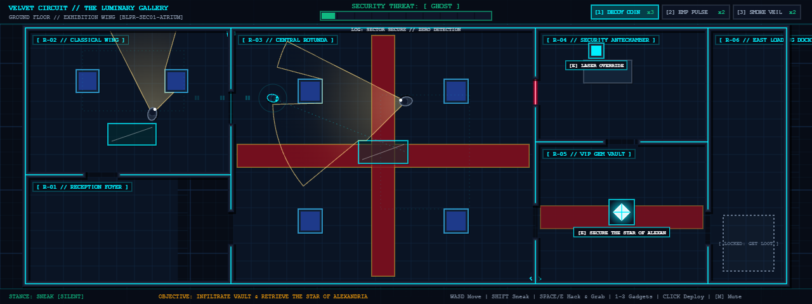
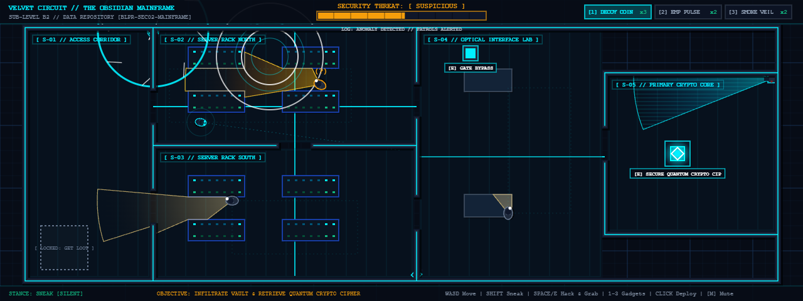
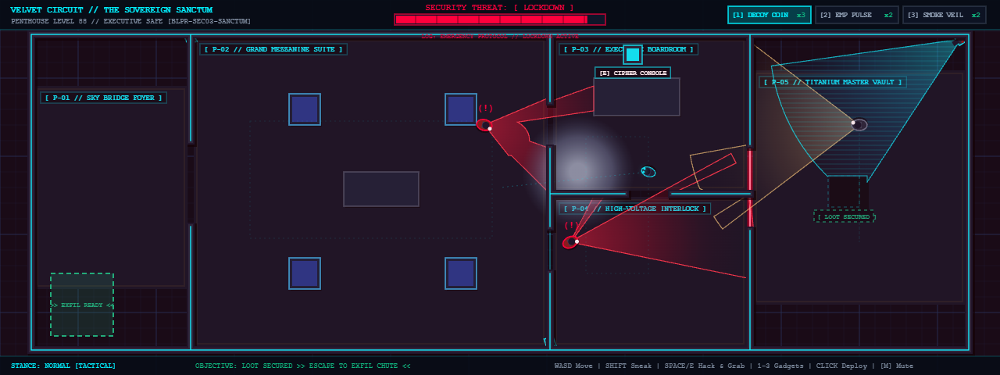
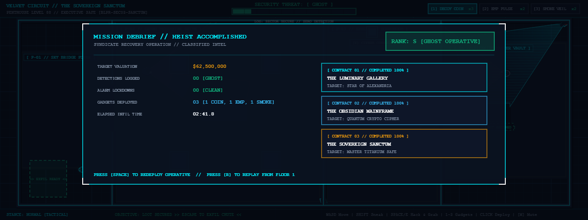

# VELVET CIRCUIT

[](https://make.fun/c/best-heist-game-20261122-0559)
[](https://make.fun/c/best-heist-game-20261122-0559)
[](https://make.fun/c/best-heist-game-20261122-0559)

> **VELVET CIRCUIT** is an original, deeply playable offline HTML5 Canvas tactical heist game designed for desktop keyboard and mouse at native 1280x480 tactical widescreen. Built for the **make.fun** bounty (`best-heist-game-20261122-0559`).

---

## Tactical Showcase

| 01. The Luminary Gallery (Hero Stealth) | 02. The Obsidian Mainframe (Gadget Distraction) |
| :---: | :---: |
|  |  |
| **03. High-Alert Vault Extraction (Lockdown)** | **04. Mission Debrief (Tactical Scorecard)** |
|  |  |

---

## Key Pillars & Systems

### 1. High-Contrast Tactical Noir Blueprint Aesthetic
- **Procedural Architectural Blueprints**: Deep navy blueprint canvas (`#070C16`) with fine orthogonal measurement grids, sector callouts, and double-line architectural structural boundaries.
- **Rich Procedural Textures**: Diamond marble tiling in the Atrium, conduit server plating in the Data Vault, and gold-trimmed granite in the Penthouse Executive Suite.
- **Volumetric Vision Cones**: Dynamic 2D raycasting against all walls and obstacles with smooth radial gradient falloff:
  - `[ GHOST ]`: Soft cyan-blue volumetric beam (`rgba(180, 230, 255, 0.28)`)
  - `[ SUSPICIOUS ]`: Pulsing amber caution beam (`rgba(255, 180, 0, 0.40)`)
  - `[ ALERT / LOCKDOWN ]`: Piercing red alarm beam (`rgba(255, 30, 60, 0.50)`)
- **Sweeping CCTV Security Beams**: Rotating wall-mounted cameras featuring moving digital scanline projection and status LEDs.
- **Coherent Laser Grids**: Pulsing security tripwires with glowing core blooms and cycling phase intervals.
- **Acoustic Sound Ripples & Footstep Trails**: Visible expanding sound waves when running or deploying noise makers, with directional boot tread trails behind the operative.

### 2. Mandatory 5 Heist Elements in Every Frame
Every gameplay frame unmistakably showcases:
1. **Multi-Room Floorplan**: Distinct architectural sectors with corridors, partitions, and furniture cover.
2. **Patrolling Guards with Raycasted Cones**: Realistic FSM sentries reacting to noise and line of sight.
3. **Sweeping Security Cameras**: Wall-mounted automated turrets with oscillating scanline beams.
4. **Glowing Loot Target**: High-value heist objectives (*The Star of Alexandria*, *Quantum Crypto Cipher*, *Sovereign Gold Ledger*).
5. **Bold Alarm Meter HUD**: Diegetic threat meter tracking `[ GHOST ]`, `[ SUSPICIOUS ]`, and `[ LOCKDOWN ]` status.

### 3. Gameplay Depth & Progressive Floors
- **Floor 1: The Luminary Gallery**: Infiltrate the high-profile art pavilion, bypass display vitrines, navigate guard patrol routes, and secure the 140-carat blue diamond.
- **Floor 2: The Obsidian Mainframe**: Sub-level data repository with crossing laser tripwires, server rack corridors, camera surveillance nets, and terminal bypass consoles.
- **Floor 3: The Sovereign Sanctum**: Executive penthouse suite with elite rapid-response enforcers, multi-point camera coverage, high-voltage interlocks, and the heavy titanium biometric safe.

### 4. Tactical Gadget Suite
- **[1] Decoy Transmitter / Coin**: Throw an acoustic beacon that clinks on impact, emitting a loud sound-wave ripple that lures guards off their patrol routes to investigate.
- **[2] EMP Disruptor Pulse**: Unleashes a localized electromagnetic shockwave that temporarily disables all cameras and laser barriers in a 280px radius for 6 seconds.
- **[3] Smoke Veil Grenade**: Deploys a dense volumetric smoke cloud that completely occludes guard vision cones and camera beams.

### 5. 100% Offline Procedural Web Audio API
- **Dynamic Tension Bassline**: Procedural real-time sound engine adjusting musical tempo, sub-bass heartbeat oscillations (55Hz), and urgent tension synths as the Alarm Meter escalates.
- **Diegetic Foley SFX**: Tactile bootsteps, metallic coin clinks, EMP power discharges, smoke hissing, computer terminal hacking sequences, and alarm sirens.
- **Zero External Audio Assets**: 100% synthesized in-memory with zero network requests.

---

## Clean Modular Architecture

```
velvet-circuit/
├── game/
│   ├── index.html                  # Offline desktop HTML5 Canvas viewport
│   └── src/
│       ├── engine/
│       │   ├── renderer.js         # Blueprint floorplans, furniture, loot & operative
│       │   ├── lighting.js         # 2D Raycast volumetric cones, scanlines, lasers & ripples
│       │   └── audio.js            # Offline procedural Web Audio API synthesizer
│       ├── ai/
│       │   ├── guardFSM.js         # Guard AI state machine (Patrol, Suspicious, Alert)
│       │   └── cameraSystem.js     # CCTV sinusoidal sweep, scanline beam & EMP disable
│       ├── world/
│       │   ├── levels.js           # 3 Handcrafted blueprints (Gallery, Vault, Penthouse)
│       │   └── raycast.js          # Visibility polygon, segment occlusion & line of sight
│       ├── gameplay/
│       │   ├── thiefController.js  # WASD movement, sneak/sprint, collision & hacking
│       │   ├── gadgets.js          # Decoy coins, EMP pulse, and smoke screen clouds
│       │   └── alarmSystem.js      # Global threat tracker (GHOST, SUSPICIOUS, LOCKDOWN)
│       ├── ui/
│       │   └── hud.js              # Mission header, gadget bar, bold threat meter & wheel
│       ├── shots.js                # Deterministic screenshot scenario staging
│       └── main.js                 # Master loop, event bindings & game bootstrap
├── screenshots/                    # 4 Native 1280x480 PNG renders (< 256 KiB each)
├── vendor/
│   └── makefun-game.ts             # Official untouched make.fun game SDK
├── shots.json                      # Deterministic screenshot configuration
├── serve.ts                        # Offline development static server
├── main.ts                         # Node.js 22 entrypoint generating /output & dossier.json
└── LICENSE                         # OSI-approved MIT License
```

---

## Controls

| Key / Action | Command | Function |
| :--- | :--- | :--- |
| **W, A, S, D** / **Arrows** | Movement | 8-directional smooth tactical movement |
| **Shift** | Sneak | Silent movement (reduces speed, suppresses noise ripples) |
| **Space** / **E** | Interact | Hack security consoles & crack vault loot pedestals |
| **Mouse Cursor** | Aim | Directs operative gaze and crosshair reticle |
| **Left Click** | Deploy Gadget | Launches selected tactical gadget to target location |
| **1, 2, 3** | Select Gadget | 1: Decoy Coin, 2: EMP Pulse, 3: Smoke Screen |
| **M** | Audio Mute | Toggles procedural Web Audio soundtrack and SFX |
| **R** | Quick Reset | Resets current floor layout |

---

## Verification & Determinism

### 1. Run Offline Local Game Server
```bash
node serve.ts --port 8080
# Open http://localhost:8080 in desktop Chrome
```

### 2. Generate Output & Dossier
```bash
# Writes /output with byte-identical determinism
node main.ts
```

### 3. Check with Official Bounty CLI
```bash
node ../best-heist-game-20261122-0559-kit/cli/makefun.mjs check --kit ../best-heist-game-20261122-0559-kit --repo .
```

---

## License

[MIT](LICENSE) © 2026 roberttijani
